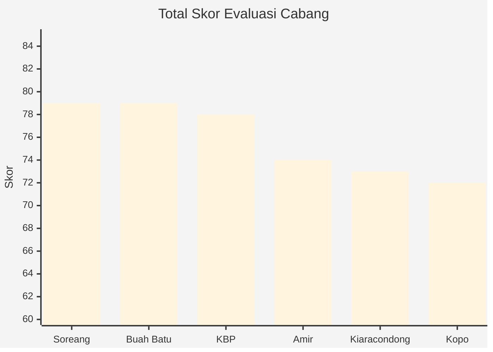

# Evaluasi Implementasi SOP Operasional & SDM (Periode Oktober 2026)

**Cakupan Cabang:** Amir, KBP, Kopo, Kiaracondong, Soreang, Buah Batu
**Fokus Evaluasi:** Pengukuran tingkat keberhasilan target bulan Agustus terkait penegakan standar operasional baru.

## Ringkasan Eksekutif

[High confidence] Target bulan Agustus untuk menegakkan SOP secara struktural menunjukkan hasil yang terpolarisasi. Secara umum, kepatuhan pada administrasi dasar (grooming dan sistem absensi) berjalan cukup baik berkat inisiatif kolektif kru atau penerapan sanksi denda. Namun, fungsi manajerial harian dari Leader cabang gagal memenuhi target standarisasi. 

**Tingkat Keberhasilan SOP Lapangan (Checklist Observasi 11-12 Poin):**
1. **Buah Batu & Amir** (±83% - 10/12 poin observasi terpenuhi)
2. **Kopo & Soreang** (±81% - 9/11 poin observasi terpenuhi)
3. **KBP & Kiaracondong** (±72% - 8/11 poin observasi terpenuhi)

Kendala struktural paling merata di seluruh cabang adalah **gagalnya rutinitas briefing pergantian shift (0% pelaksanaan rutin dari 6 cabang)**. Selain itu, empat dari enam Leader (KBP, Kopo, Kiaracondong, Soreang) terpantau tidak melakukan teguran langsung di lapangan saat terjadi pelanggaran, yang mengindikasikan fungsi pengawasan masih sangat lemah dan terlalu bergantung pada sidak HR/EXPA.

### Visualisasi Data Utama

#### Perbandingan Skor Akhir Cabang (Skala 100)

## Analisa Spesifik per Cabang

### 1. Soreang (Skor Akhir: 79)
Soreang menunjukkan sistem manajerial yang secara administratif berjalan baik, terutama dalam penegakan disiplin waktu melalui Surat Peringatan (SP).

* **Pemenuhan SOP:** Keberhasilan utama ada pada penurunan drastis angka keterlambatan dan penyelesaian konflik staf di luar pekerjaan. Penambahan kru langsung meningkatkan kelancaran *teamwork*.
* **Area Perbaikan:** Pelaksanaan briefing sangat jauh dari target (hanya 2-3 minggu sekali). Ketidaktegasan menegur di tempat membuat pelanggaran perawatan diri (rambut/kuku) lolos. Inisiatif pembersihan lantai *take-away* di pagi hari masih absen, menunggu shift siang turun tangan.
* **Tindakan Lanjutan:** Leader wajib dipaksa menjadwalkan briefing harian tanpa menunggu alasan "flow kru baru membaik".

### 2. Buah Batu (Skor Akhir: 79)
Cabang ini unggul dalam kebersihan area dan strategi pengelolaan SDM harian, namun mengalami kebocoran di sisi absensi.

* **Pemenuhan SOP:** Rotasi kru perempuan ke area *kitchen* terbukti sebagai taktik *backup* yang cerdas. Kebersihan fisik nyaris sempurna. Leader tegas memberi sanksi denda terkait *grooming*.
* **Area Perbaikan:** Penegakan SOP absensi gagal total. Ketidakhadiran melonjak ke angka 45 (dari 15 staf), disertai peningkatan izin tanpa ada teguran administratif (SP) dari Leader. Laporan briefing tidak konsisten dengan observasi lapangan (diklaim 15/15 tapi checklist mencatat FALSE saat operasional).
* **Tindakan Lanjutan:** Penerbitan SP bagi kru dengan tingkat ketidakhadiran tidak wajar harus segera dieksekusi, tidak sebatas evaluasi lisan.

### 3. KBP (Skor Akhir: 78)
Kelancaran operasional di KBP lebih bertumpu pada alat bantu sistem daripada kemampuan manajerial Leader.

* **Pemenuhan SOP:** Target SOP pembagian area melalui sistem *checklist* berhasil diterapkan dan efektif menghentikan perdebatan kru. Solidaritas kru tinggi (menalangi nametag rusak).
* **Area Perbaikan:** Leader sangat pasif; menghindari pemberian teguran langsung (observasi FALSE) dan belum mengeksekusi instruksi SPV untuk briefing mingguan. Dampaknya, kedisiplinan kru merosot (datang mepet waktu) dan area fisik mulai terabaikan (genangan air, bau, dan gorden lusuh).
* **Tindakan Lanjutan:** Intervensi HR untuk mengubah kebiasaan pasif Leader. Fasilitas area luar perlu segera dirapikan sebelum memicu keluhan pelanggan.

### 4. Amir (Skor Akhir: 74)
Titik lemah Amir terpusat pada pembiaran konflik internal yang berdampak langsung pada area layanan pelanggan.

* **Pemenuhan SOP:** Kedisiplinan absensi membaik (angka tidak masuk turun). SOP kebersihan area dine-in berjalan sangat baik dengan respons *clear-up* yang cepat. Rencana penggunaan "kartu teguran toilet" adalah inisiatif kreatif.
* **Area Perbaikan:** Konflik teritorial antara dua staf dibiarkan berulang oleh leader. Hal ini memicu pelanggaran SOP nomor 6 (perdebatan/raut wajah tidak ramah di depan pelanggan). Briefing belum menjadi fungsi baku harian.
* **Tindakan Lanjutan:** Leader Amir wajib diberi tenggat waktu untuk menertibkan dua staf yang berkonflik menggunakan SP.

### 5. Kiaracondong (Skor Akhir: 73)
Operasional cabang bertahan melalui inisiatif cerdik para kru, di tengah kurangnya fungsi komunikasi dari Leader dan keterbatasan fisik outlet.

* **Pemenuhan SOP:** SOP grooming meraih skor maksimal berkat kesepakatan kru menyimpan atribut di outlet. Absensi tanpa keterlambatan, dan inisiatif *teamwork* saat menerima order berjalan sangat mulus.
* **Area Perbaikan:** Terjadi disonansi; Leader mengklaim fungsi *coaching* "man-to-man" berjalan, namun form evaluasi membuktikan sebaliknya, ditunjang dengan nihilnya briefing (FALSE). Kondisi area kurang layak (kasir sempit, penumpukan alat, dan area driver tidak memadai).
* **Tindakan Lanjutan:** HR/SPV perlu melakukan pemanggilan terhadap Leader Kiaracondong untuk mengkalibrasi komunikasi dengan kru. Usulan kru mengganti wadah telur menjadi plastik wajib dieskalasi ke *Purchasing* sebagai standar kontrol hama lintas cabang.

### 6. Kopo (Skor Akhir: 72)
Satu-satunya cabang yang mengalami krisis fungsi manajerial yang mengharuskan intervensi pihak luar, diperparah dengan infrastruktur bangunan yang sudah tidak layak.

* **Pemenuhan SOP:** Kepatuhan SOP kedisiplinan dan *teamwork* patut diacungi jempol. Rekor nihil telat selama 2 bulan, kru rutin hadir 15 menit awal, dan saling inisiatif mem-*backup* posisi kerja tanpa instruksi saat jam sibuk.
* **Area Perbaikan:** Fungsi Leader mati; menghindari briefing dan tidak mampu menangani masalah internal akibat ego personal, sehingga pemecahan masalah harus diambil alih EXPA. Fisik ruko menimbulkan risiko eksternal (kebocoran merusak properti ruko tetangga dan komplain lahan parkir dengan salon lantai atas).
* **Tindakan Lanjutan:** Proposal pemindahan lokasi cabang Kopo harus segera diproses ke pimpinan, mengingat perbaikan inisiatif staf tidak akan menutup akar masalah fasilitas bangunan. Kelayakan Leader saat ini perlu dievaluasi ketat.

---

## Kesimpulan Strategis (Level Manajemen)

1. **Krisis Kontrol Harian Leader:** Dari hasil sinkronisasi dengan target Agustus, inisiatif sanksi denda (grooming) dan pembuatan checklist (teamwork) cukup efektif. Namun, **kewajiban briefing pergantian shift 100% gagal dijalankan** sebagai prosedur standar harian. Leader di Amir, KBP, Kiaracondong, dan Kopo terpantau menghindari tanggung jawab menegur kru secara langsung. Perlu ada metrik KPI baru khusus mengukur pelaksanaan briefing harian, bukan sekadar pelaporan bulanan.
2. **Standardisasi Fasilitas & Hama:** Ide pergantian wadah telur ke bahan plastik dari Kiaracondong harus disahkan menjadi SOP Divisi Purchasing untuk mitigasi hama di seluruh cabang.
3. **Eskalasi Infrastruktur:** Masalah bangunan di Kopo (bocor, sengketa lahan) dan Kiaracondong (area operasional sempit) sudah melewati batas kendali inisiatif cabang. Hal ini membutuhkan keputusan relokasi secepatnya dari pihak manajemen atas.

 
 

***

## Lampiran 1: Data Penilaian Keseluruhan Aspek Outlet

| Cabang | HR & Admin (Grooming) | HR & Admin (Absensi) | HR & Admin (Teamwork) | HR & Admin (Coaching) | HR & Admin (Konflik) | Area Audit (Kebersihan) | Skor Total |
| :--- | :--- | :--- | :--- | :--- | :--- | :--- | :--- |
| **Soreang** | 12 / 15 | 16 / 20 | 24 / 30 | 9 / 15 | 10 / 10 | 8 / 10 | **79** |
| **Buah Batu** | 12 / 15 | 8 / 20 | 24 / 30 | 15 / 15 | 10 / 10 | 10 / 10 | **79** |
| **KBP** | 12 / 15 | 12 / 20 | 24 / 30 | 12 / 15 | 10 / 10 | 8 / 10 | **78** |
| **Amir** | 12 / 15 | 16 / 20 | 18 / 30 | 12 / 15 | 6 / 10 | 10 / 10 | **74** |
| **Kiaracondong** | 15 / 15 | 16 / 20 | 24 / 30 | 6 / 15 | 6 / 10 | 6 / 10 | **73** |
| **Kopo** | 12 / 15 | 20 / 20 | 24 / 30 | 6 / 15 | 4 / 10 | 6 / 10 | **72** |

## Lampiran 2: Checklist Observasi Outlet Saat Visit (Data Mentah TRUE/FALSE)

*Tabel di bawah menyatukan komponen dari 11-12 instrumen observasi standar.*

| Item Observasi | Amir | KBP | Kopo | Kircon | Soreang | B. Batu |
| :--- | :---: | :---: | :---: | :---: | :---: | :---: |
| 1. Kru memakai seragam rapi, atribut lengkap | TRUE | TRUE | TRUE | TRUE | TRUE | TRUE |
| 2. Perawatan diri (rambut, kuku) terawat standar | TRUE | TRUE | TRUE | TRUE | **FALSE** | TRUE |
| 3. Jam masuk/pulang absen sesuai realita | TRUE | TRUE | TRUE | TRUE | TRUE | TRUE |
| 4. Tidak ada hadir terlambat / pergi tanpa izin | TRUE | TRUE | TRUE | TRUE | TRUE | **FALSE** |
| 5. Komunikasi antar station lancar, saling bantu | TRUE | TRUE | TRUE | TRUE | TRUE | TRUE |
| 6. Tidak ada perdebatan/raut tidak ramah ke pelanggan | **FALSE** | TRUE | TRUE | TRUE | TRUE | TRUE |
| 7. Briefing shift **selalu** dilakukan | **FALSE** | **FALSE** | **FALSE** | **FALSE** | **FALSE** | **FALSE** |
| 8. Leader **langsung** menegur di lapangan | TRUE | **FALSE** | **FALSE** | **FALSE** | **FALSE** | TRUE |
| 9. Meja / area tunggu (driver) segera dibersihkan | TRUE | TRUE | TRUE | **FALSE** | TRUE | TRUE |
| 10. Lantai dine-in/toilet bersih, tak ada genangan | TRUE | **FALSE** | TRUE | TRUE | TRUE | TRUE |
| 11. Meja kasir, area umum rapi/sabun tersedia | TRUE | TRUE | TRUE | **FALSE** | TRUE | TRUE |